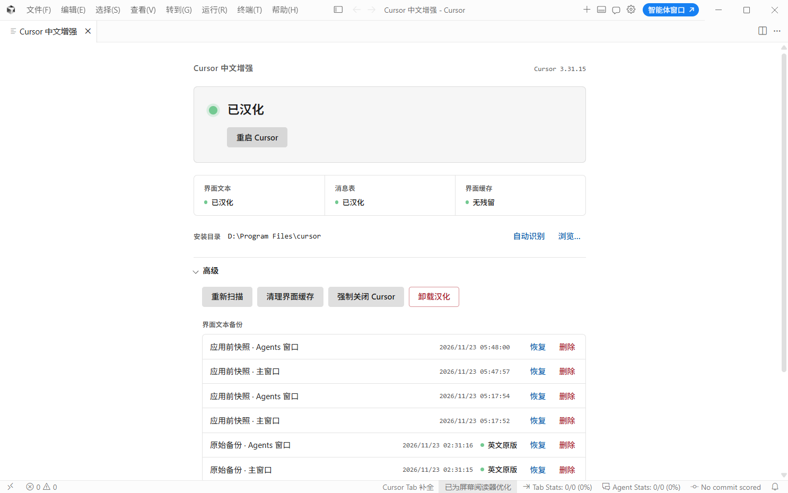
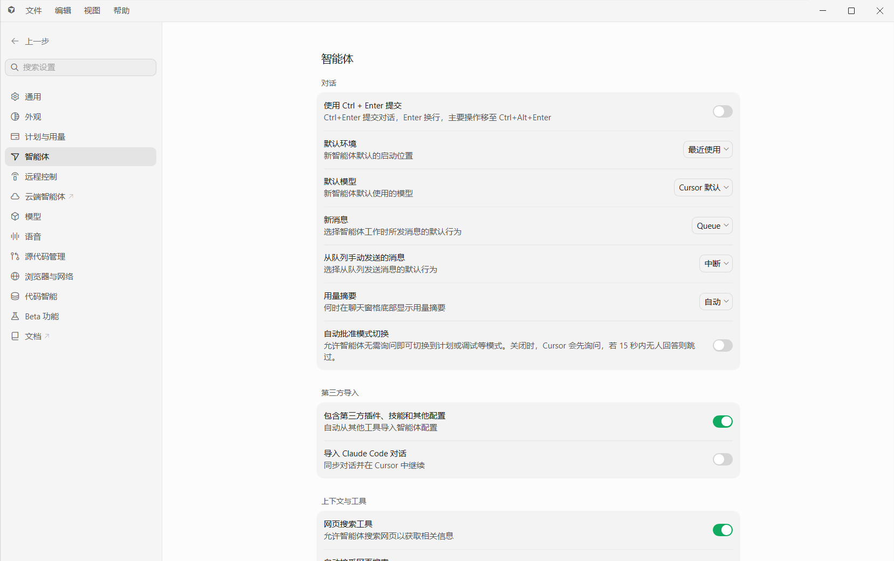
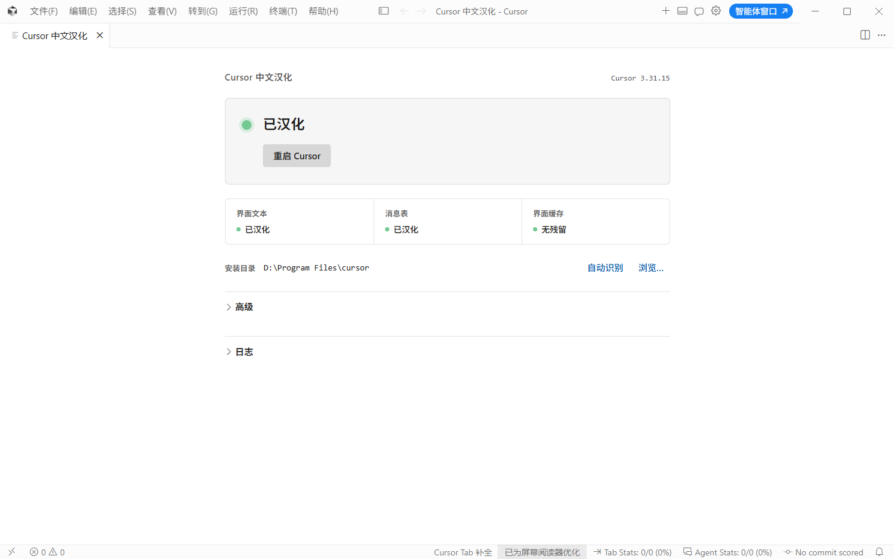
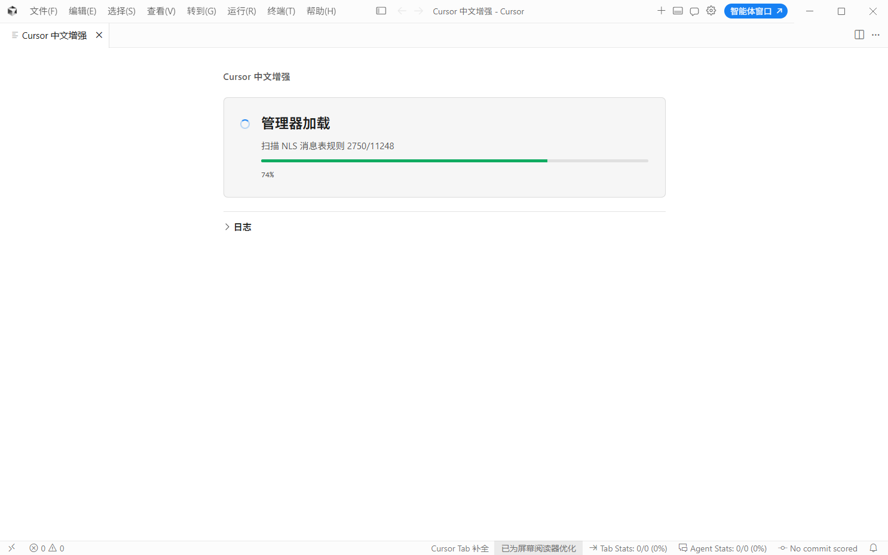

<h1 align="center">Cursor 中文增强</h1>

<p align="center">
  <b>Translate the rest of Cursor into Simplified Chinese.</b><br>
  Microsoft's Chinese language pack only covers the parts Cursor shares with VS Code. This extension translates the rest: Cursor's own UI, the Agents window and its private message table.<br>
  It backs up every file before writing, can be reverted at any time, and never touches accounts, networking or model settings.
</p>

<p align="center">
  <a href="https://github.com/sooua/cursor-zh-plus/releases"></a>
  
  
  
</p>

<p align="center">
  <a href="README.md">简体中文</a> · <b>English</b> · <a href="https://github.com/sooua/cursor-zh-plus/releases">Download</a> · <a href="https://github.com/sooua/cursor-zh-plus/issues">Report an issue</a>
</p>

<p align="center">
  
</p>

## Why use it

- **Only the gaps.** VS Code's own UI is still translated by Microsoft's official pack. This extension handles Cursor's settings pages, Composer / Agent menus, the Agents window and private messages, so the two packs never conflict.
- **Always reversible.** It saves the original English file before the first write, and takes a snapshot before every uninstall or restore. The main window, Agents window and message table are each backed up and restored on their own.
- **Text only.** Rules match on code context, never on a global find-and-replace. Bracket structure and protected keywords are checked before writing, and hashes after. Network requests, accounts, tool permissions, model parameters and feature flags are never touched.
- **One button at a time.** The manager reads the current state and shows only the next step: locate Cursor, apply, restart.

## Quick start

You need Cursor 3.31.15 for Windows and Microsoft's `MS-CEINTL.vscode-language-pack-zh-hans`.

1. Install the Microsoft Chinese language pack, run `Configure Display Language` and pick `zh-cn`.
2. Download `cursor-zh-plus-<version>.vsix` from [Releases](https://github.com/sooua/cursor-zh-plus/releases) and use **Install from VSIX** in Cursor.
3. Run **Cursor 中文增强：打开管理器** from the Command Palette and click **应用汉化** (Apply).
4. Click **重启 Cursor** (Restart). A helper process closes Cursor, clears cached UI text, rebuilds the language-pack cache and reopens Cursor.

The manager looks for Cursor in this order: saved setting → running `Cursor.exe` → `PATH` → registry → common install paths. If none of them works, click **浏览…** (Browse) and pick the folder that contains `resources\app`.

## Features

| Layer | Target | How |
| --- | --- | --- |
| Cursor extensions | `anysphere.cursor-*` | Standard language pack, no install files changed |
| Main window | `out/vs/workbench/workbench.desktop.main.js` | Patched by the manager |
| Agents window | `out/vs/workbench/workbench.glass.main.js` | Patched by the manager (if present) |
| Message table | `out/nls.messages.json` | Exact module/key match with placeholder check |

The current rule set has 9,092 UI patch rules and 11,248 message-table rules, covering settings, menus, extensions / MCP, the browser and more.

<p align="center">
  
</p>

Under **高级** (Advanced): rescan, clear UI cache, force-quit Cursor, uninstall, and per-target backup restore and delete.

<table>
  <tr>
    <td></td>
    <td></td>
  </tr>
</table>

## How it works and what it changes

- **Files written**: only the three install files in the table above, and only after you click Apply.
- **Data cleared**: on restart, cached English UI text in `%APPDATA%\Cursor\User\globalStorage\state.vscdb` and the zh-cn language-pack cache. These are deleted, never rewritten, and Cursor regenerates them on the next launch.
- **Never touched**: your projects, chat content, setting values, command IDs, and any networking or account code.
- **Integrity warning**: changing install files triggers Cursor's "installation appears to be corrupt" notice. The extension rewrites it into an explanation that is safe to ignore.

## Supported versions

| Component | Support |
| --- | --- |
| Cursor | 3.31.15 for Windows. Other versions can be scanned, but rules may not match |
| Base language pack | `MS-CEINTL.vscode-language-pack-zh-hans` |
| Engine | VS Code API `^1.105.0` |

A Cursor update overwrites the patched files. After updating, open the manager. If it shows 部分汉化 (partially translated), click 重新应用 (Re-apply). Text the rules no longer match stays in English.

<details>
<summary><b>Development</b></summary>

```powershell
npm ci
npm run compile
npm run package        # build the .vsix
npm run release:build  # release assets in artifacts/release/
```

Maintenance scripts read `D:\cursor` by default. Override with `CURSOR_ROOT` or a command-line argument.

| Command | Purpose | Output |
| --- | --- | --- |
| `npm run extract` | Extract Cursor extension translations | `translations/extensions/*.i18n.json` |
| `npm run scan:workbench` | Find untranslated hard-coded text | `reports/workbench-untranslated.*` |
| `npm run scan:patch-sources` | Generate candidate patch rules | `data/workbench-patches.staging.json` |

Pushing to `main` with a commit message whose first line is `vX.Y.Z`, followed by lines starting with `- `, creates a GitHub Release.

</details>

## Support

- **Questions and bugs**: open an [issue](https://github.com/sooua/cursor-zh-plus/issues) with your Cursor version and the manager log.

## License

MIT, see [LICENSE](LICENSE). Part of the message-table translations come from Microsoft's Chinese (Simplified) Language Pack; see [THIRD-PARTY-NOTICES.md](THIRD-PARTY-NOTICES.md).

Cursor is a trademark of Anysphere, Inc. This is an independent community project, not affiliated with, endorsed by or sponsored by Anysphere; the name only identifies the software it works with.
