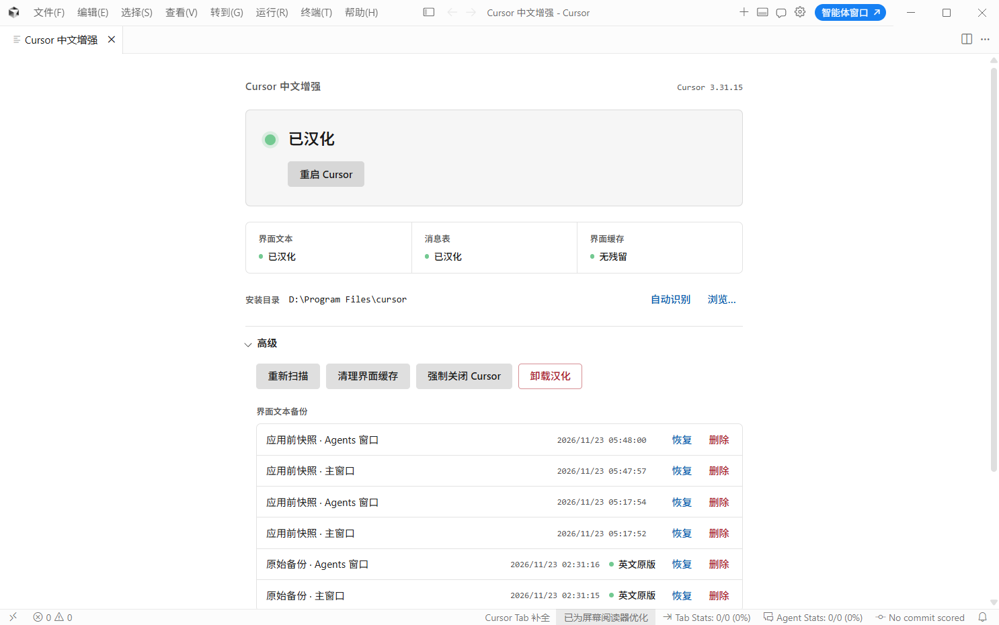
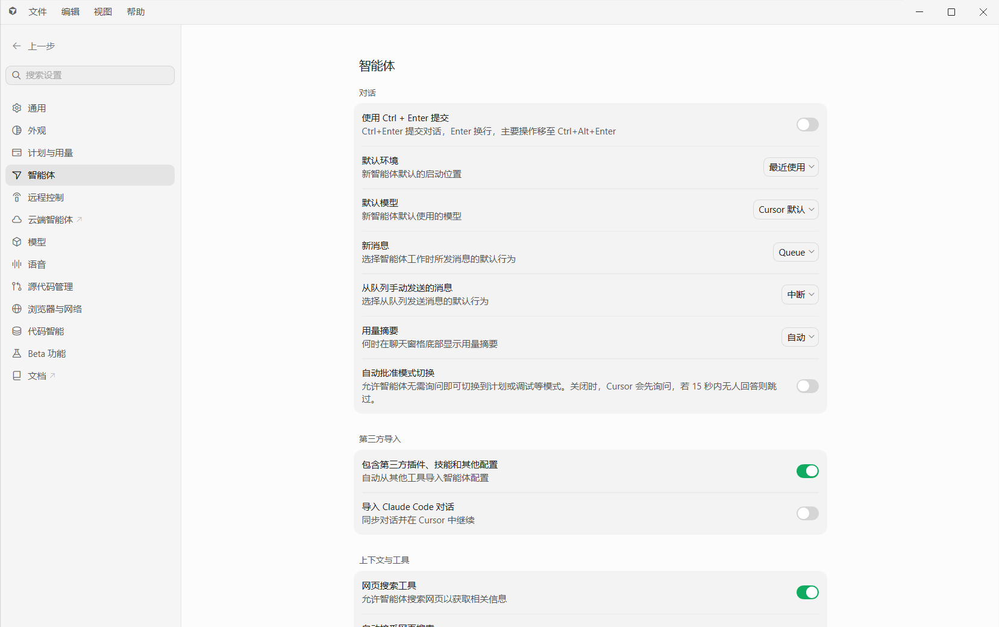
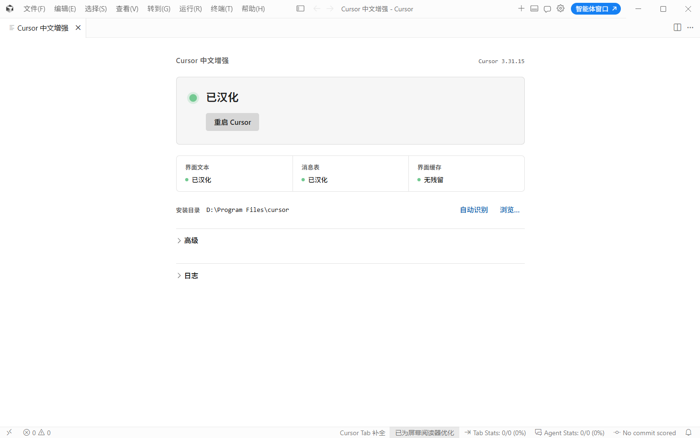
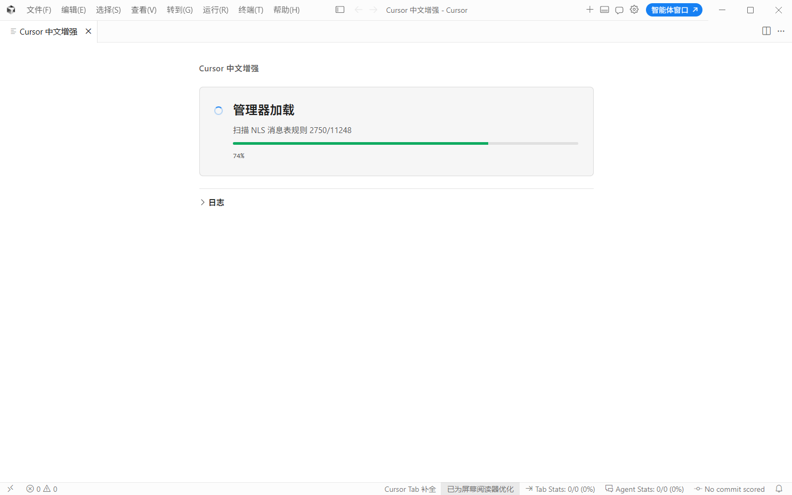

<h1 align="center">Cursor 中文增强</h1>

<p align="center">
  <b>让 Cursor 剩下的英文界面也变成中文。</b><br>
  微软简体中文语言包只翻译 VS Code 自带的部分。本扩展补齐 Cursor 私有界面、Agents 窗口和消息表中的英文：<br>
  写入前自动备份，随时一键还原，不改动账户、网络和模型设置。
</p>

<p align="center">
  <a href="https://github.com/sooua/cursor-zh-plus/releases"></a>
  
  
  
</p>

<p align="center">
  <b>简体中文</b> · <a href="README.en.md">English</a> · <a href="https://github.com/sooua/cursor-zh-plus/releases">下载</a> · <a href="https://github.com/sooua/cursor-zh-plus/issues">反馈问题</a>
</p>

<p align="center">
  
</p>

## 为什么用它

- **只补缺口。** VS Code 通用界面继续交给微软官方语言包，本扩展只处理 Cursor 自己的设置页、Composer / Agent 菜单、Agents 窗口和私有消息，两者不冲突。
- **随时可以还原。** 第一次写入前保存英文原版备份，卸载和恢复前也会先存快照。主窗口、Agents 窗口和消息表分开备份、分开恢复。
- **只改文案。** 规则按代码上下文匹配，不做全局查找替换。写入前检查括号结构和受保护的关键字，写入后核对哈希。网络请求、账户、工具权限、模型参数和功能开关都不会被改动。
- **一个按钮走完流程。** 管理器根据当前状态只给出下一步：识别目录、应用汉化、重启生效。

## 快速开始

需要 Windows 版 Cursor 3.31.15，以及微软官方扩展 `MS-CEINTL.vscode-language-pack-zh-hans`。

1. 安装微软简体中文语言包，在命令面板运行 `Configure Display Language`，选择 `zh-cn`。
2. 从 [Releases](https://github.com/sooua/cursor-zh-plus/releases) 下载 `cursor-zh-plus-<版本>.vsix`，在 Cursor 扩展面板中选择 **从 VSIX 安装**。
3. 命令面板运行 **Cursor 中文增强：打开管理器**，点击 **应用汉化**。
4. 点击 **重启 Cursor**。独立助手会关闭 Cursor、清理界面缓存、重建语言包缓存，然后重新打开 Cursor。

管理器会自动查找安装目录，顺序为：已保存的配置 → 正在运行的 `Cursor.exe` → `PATH` → 注册表 → 常见安装路径。找不到时点 **浏览…** 手动选择包含 `resources\app` 的目录。

## 功能

| 层级 | 目标文件 | 方式 |
| --- | --- | --- |
| Cursor 专用扩展 | `anysphere.cursor-*` | 标准语言包机制，不改安装目录 |
| 主窗口界面 | `out/vs/workbench/workbench.desktop.main.js` | 管理器写入补丁 |
| Agents 窗口 | `out/vs/workbench/workbench.glass.main.js` | 管理器写入补丁（文件存在时） |
| 消息表 | `out/nls.messages.json` | 按 module/key 精确匹配并校验占位符 |

当前规则包含 9,092 条界面补丁规则和 11,248 条消息表规则，覆盖设置、菜单、插件 / MCP、浏览器等界面。

<p align="center">
  
</p>

管理器的 **高级** 中还有：重新扫描、清理界面缓存、强制关闭 Cursor、卸载汉化，以及按目标分组的备份恢复和删除。

<table>
  <tr>
    <td></td>
    <td></td>
  </tr>
</table>

## 工作原理与修改边界

- **会修改的文件**：只有上表中 Cursor 安装目录里的三个文件。点击 **应用汉化** 后才会写入。
- **会清理的数据**：重启时清理 `%APPDATA%\Cursor\User\globalStorage\state.vscdb` 中缓存的英文界面文本，以及 zh-cn 语言包的合成缓存。缓存只会删除、不做替换，Cursor 下次启动时会重新生成。
- **不会碰的内容**：你的项目文件、聊天内容、配置值、命令 ID，以及任何网络或账户相关代码。
- **完整性提示**：修改安装文件会触发 Cursor 的“安装已损坏”提示。扩展会把它改写为说明文字，可以放心忽略。

## 支持的版本

| 组件 | 支持情况 |
| --- | --- |
| Cursor | 3.31.15，Windows 版。其他版本可以扫描，但规则不一定匹配 |
| 基础语言包 | `MS-CEINTL.vscode-language-pack-zh-hans` |
| 引擎 | VS Code API `^1.105.0` |

Cursor 升级会覆盖已打补丁的文件。升级后打开管理器：显示“部分汉化”时点 **重新应用**，规则匹配不上的文案会保持英文。

<details>
<summary><b>开发与维护</b></summary>

```powershell
npm ci
npm run compile
npm run package        # 生成 .vsix
npm run release:build  # 在 artifacts/release/ 生成发布资产
```

维护脚本默认读取 `D:\cursor`，可用环境变量 `CURSOR_ROOT` 或命令行参数覆盖。

| 命令 | 作用 | 产物 |
| --- | --- | --- |
| `npm run extract` | 提取 Cursor 专用扩展翻译 | `translations/extensions/*.i18n.json` |
| `npm run scan:workbench` | 扫描 workbench 中未翻译的硬编码文案 | `reports/workbench-untranslated.*` |
| `npm run scan:patch-sources` | 生成可写入补丁表的候选规则 | `data/workbench-patches.staging.json` |

| 规则文件 | 用途 |
| --- | --- |
| `data/workbench-patches.json` | workbench 补丁替换表 |
| `data/workbench-patch-runtime-policy.json` | 运行时安全策略 |
| `data/nls-message-patches.json` | 消息表补丁 |
| `data/local-33115-translations.json` | 3.31.15 人工整理译文 |
| `data/nls-exact-translations.json` | 提取脚本使用的精确翻译表 |

| 配置项 | 说明 | 默认 |
| --- | --- | --- |
| `cursorZhCn.cursorRoot` | Cursor 安装根目录，如 `D:\cursor` | 空（自动识别） |
| `cursorZhCn.enableWorkbenchPatch` | 是否允许修改 workbench 文件 | `true` |

推送到 `main` 时，如果提交信息首行为 `vX.Y.Z`、后续每行以 `- ` 开头，工作流会自动创建 GitHub Release。

</details>

## 支持

- **问题与建议**：提交 [issue](https://github.com/sooua/cursor-zh-plus/issues)，附上 Cursor 版本和管理器日志。

## 许可

MIT，见 [LICENSE](LICENSE)。消息表中的部分译文来自微软简体中文语言包（© Microsoft Corporation，MIT）。

Cursor 是 Anysphere, Inc. 的商标。本项目是独立的社区项目，与 Anysphere 没有隶属、认可或赞助关系，提及该名称仅用于说明适用的软件。
